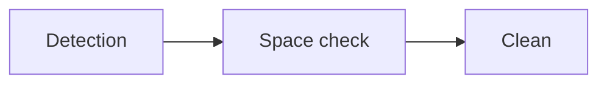
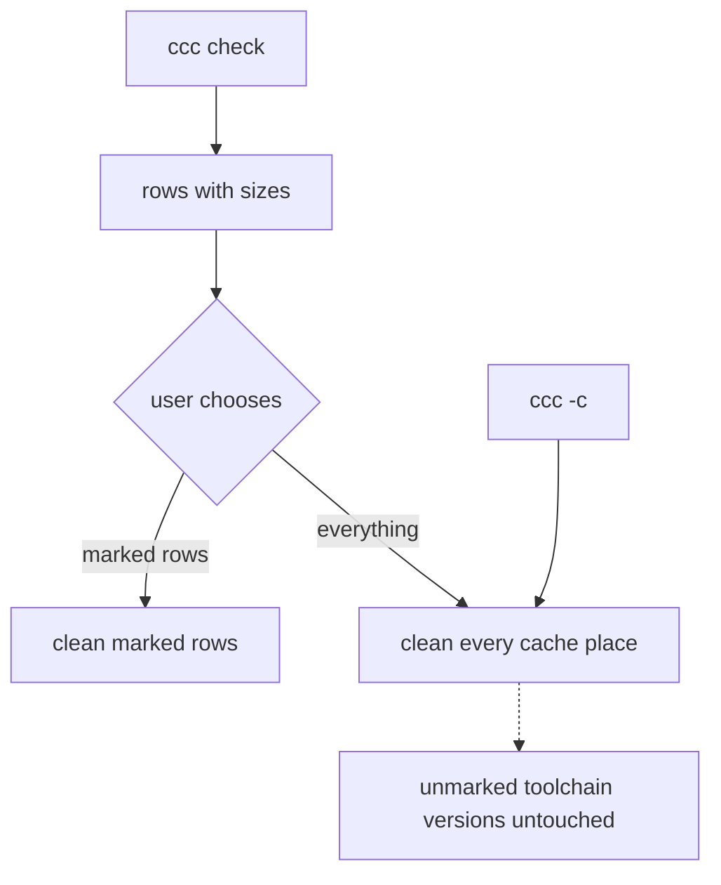

# ccc — requirements

`ccc` ("cute cache cleaner") is a command-line program that shows how much disk space the
caches and the installed toolchain versions of developer tools take on a machine, and cleans
them. It knows each tool through a registry entry that says how to find the tool's places — the directories and other storage
where it keeps caches or installed versions — how to measure them and how to clean them.

## Who it is for and why

The user is a developer whose disk fills up with caches of the tools they work with. The owner
of this project is the first such user. `ccc` is published as a public repository and runs on
macOS and on Linux. Windows is not supported.

The problem: on a developer's machine these caches grow to tens of gigabytes, and nothing
removes them. Getting the space back is a manual pass over the caches of Go, Rust, npm, bun,
pip, Puppeteer, Homebrew, Docker and the build directories inside projects, and for each one
somebody has to know three things:

- where the tool keeps its cache on this particular machine — Rust alone has four different
  places (build output, package registry, installed toolchains, compiler cache), and its build
  output moves to a shared directory when the user sets `build.target-dir` in the Cargo
  configuration;
- how big it is;
- how it is removed — the Go module cache consists of read-only files and is removed with
  `go clean -modcache`, Docker's build cache is not a directory at all and is removed with
  `docker builder prune`.

`ccc` holds that knowledge so that the pass becomes one command.

## Why existing tools are not enough

The survey is in [existing-cleaners.md](../research/tool-caches/existing-cleaners.md). Its
conclusion:

- Mole (`mo`) calls the tools' own clean commands and, for some tools, asks the tool for its
  cache path. Its list of tools is program code, so a user cannot add a tool without changing
  and rebuilding the program. It runs on macOS, with Windows on a separate branch, and not on
  Linux.
- BleachBit keeps its knowledge as data that a user can extend, but an entry cannot ask a tool
  where its cache is and cannot obtain a size from a command.
- devclean covers macOS and Linux and shows sizes with selection, but its list of tools is
  program code as well, and user configuration is not implemented.

No surveyed tool describes a developer tool as user-editable data that covers finding the
cache, measuring it and cleaning it with the tool's own command.

## The registry

Everything `ccc` knows is in a registry of entries. An entry has a kind:

- `tool` — a developer tool such as Docker, Rust or pip;
- `folder` — a directory the user points at.

The entries shipped with `ccc` are the default contents of that registry: a shipped entry and
an entry added by the user follow the same contract.
The user adds an entry with a command, and the registry is text the user can also edit by
hand: TOML, one file per tool. The shipped entries are built into the program and are updated
together with it. A user file with the same tool name replaces the shipped entry of that tool
as a whole. The reasons for the format are in
[01-discovery.md](../research/01-discovery.md#the-registry-file-format).

### The contract of an entry

An entry describes three steps. They are also the steps of adding a new tool.

**Detection — is the tool here, and where are its places on this machine.**

- A tool counts as present when its executable is on `PATH` or one of its directory places
  exists on disk. A cache often outlives the tool that made it.
- An entry lists places, not one path. A place is either a directory, or a part of the tool's
  storage that only the tool itself can list and that has no directory of its own, such as
  Docker's build cache. npm has the directories `_cacache` and `_npx`.
- Each place is declared either as a cache or as installed versions. A cache place yields one
  row. A place of installed versions yields one row per version: the entry says how the
  versions are listed, and the space check and the clean step apply to one version at a time
  (`rustup toolchain list`, `rustup toolchain uninstall <name>`).
- The path of a directory place is resolved in this order: a command of the tool that prints
  it (`go env GOCACHE` prints the Go build cache), then an environment variable, then a default
  path given per operating system. A default path may refer to an environment variable. When a
  source gives nothing — the tool is not installed, its command fails, the variable is not
  set — the next source is tried. A shipped entry never contains a path that is true only for
  one person's machine.
- A directory place is a specific directory, never the directory above it. `~/.bun` contains
  the `bun` executable itself; the Cargo home contains `credentials.toml`.
- Detection of a place ends in one of three results: found; not present on this machine; could
  not be determined. A place that is not present is not shown at all. "Could not be determined"
  is the result only when no source of the path worked; it is shown as an error and never as a
  size of zero.
- A command of an entry is run directly, not through a shell. A command and a path may contain
  the placeholders `<version>` and `<path>`, which stand for the name of one installed version
  and for the resolved path of the place.

**Space check — how much each place takes.**

- Either the disk usage of the resolved path, counted by allocated blocks, or a command of the
  tool whose output is parsed (`docker system df`, `uv cache size`).
- When measuring needs something that is absent — a daemon that is not running, administrator
  rights — the place is shown as "not measured" with the reason, never as zero. `ccc` never
  asks for administrator rights itself.
- A Docker row shows what cleaning would free, as Docker reports it, not the size of Docker's
  disk image file.

**Clean — how each place is cleaned.**

- The tool's own command (`go clean -modcache`, `docker builder prune`), or removal of the
  directory when the tool has no such command.
- A step that must run before cleaning, such as stopping a server (`sccache --stop-server`),
  is part of the entry.
- When the tool has been uninstalled and its directory is still there, the directory is
  measured by disk usage and cleaned by removing it.
- `ccc` does not check whether a place is in use by a running process.

An entry of kind `folder` is the same contract in its simplest form: the user gives the path,
the size is the disk usage of that path, and cleaning removes the directory itself.

### What the shipped registry contains

- Caches that a tool keeps in one location for the whole user account or the whole machine.
  Caches that a tool creates inside each project directory are not shipped entries; see
  [Non-goals](#non-goals). A shared Rust build directory is not a shipped entry either: it
  exists only where a user configured it, and that user adds it as a `folder`.
- Docker images count as a cache, and cleaning removes only the images no container uses
  (`docker image prune -a`).
- An entry is shipped only when its detection and its space check were confirmed by running
  them on a machine that has the tool, and its clean command comes from the tool's official
  documentation. A description with unverified fields is not shipped.
- Installed versions of toolchains — Rust toolchains of `rustup`, Node versions of `nvm`,
  Python versions of `pyenv`. These are not caches.
- These are user data and are not in the shipped registry, and `ccc` never removes them: Docker volumes, Xcode `Archives`,
  simulator and emulator devices, virtual environments that Poetry keeps inside its cache
  directory.

The raw material for the shipped entries is a catalog of 142 tool descriptions collected from
official documentation, in `docs/research/tool-caches/`:
[JavaScript](../research/tool-caches/javascript.md),
[Python and ML](../research/tool-caches/python-ml.md),
[compiled languages](../research/tool-caches/compiled-languages.md),
[JVM, mobile, Apple, .NET, Ruby, PHP, editors](../research/tool-caches/jvm-mobile-apple-dotnet.md),
[containers, infrastructure, system package managers](../research/tool-caches/containers-infra-system.md).
A field is marked `unverified` when it could be confirmed neither in the tool's official
documentation nor by running a read-only command. 127 of the 142
descriptions contain at least one such field.

## Use cases

### See what takes space

The user runs `ccc check`, or `ccc` without arguments. It is an interactive screen. `ccc` runs detection and the space
check for every entry of the registry and shows what was found and how much each place takes.
Nothing is removed until the user asks for cleaning on that screen. The screen shows sizes
only: not when a place was last used, and not whether something is using it.

`ccc` does not explain what a cache is for, whether it will be downloaded again or how long a
rebuild will take: the user looks at the numbers and decides.

### Clean a selection

On the `ccc check` screen the user marks rows with the space bar and cleans the marked ones.
The user can also clean everything at once from that screen; "everything" there means the same
as in the next use case. Before cleaning from the screen, `ccc` asks for one confirmation that
lists the rows and their total size.

After cleaning, `ccc` shows how much space each row freed and the total. A row whose cleaning
failed does not stop the others: it is marked as failed with the message of the tool, and the
failures are summed up at the end.

### Clean everything

The user runs `ccc --clean` (short form `ccc -c`). `ccc` cleans every cache place of every
`tool` entry and every `folder` entry, without asking for confirmation: the command itself is
the request. Rows of installed toolchain versions are not touched by "clean everything",
neither here nor on the `ccc check` screen: a version is removed only when the user marks its
row. Otherwise the command would remove the only installed toolchain and nothing would build
afterwards.

### Add a tool

The user runs `ccc add` and goes through the three steps of the contract in a form: how the
tool is detected and where its places are, how its space is checked, how it is cleaned. After
the first two steps `ccc` runs what was entered and shows the result — the path found, the size
measured — so a mistake is seen before the entry is saved. The clean step is never run by the
form. The new
entry lands in the registry and appears in `ccc check` from then on. The owner's example: a
user who wants one of Docker's `prune` commands, whichever they choose, as an entry of its own
adds it this way.

### Add a folder

The user runs `ccc add <path>`, which adds the path as an entry of kind `folder`. Its size is shown in `ccc check` next to
the tools, and cleaning removes it. The entry stays in the registry after that, and its row
comes back when the directory exists again. This is how a directory inside a project — a `.next`, a
`node_modules`, a `.terraform/providers` — gets into `ccc`.

## The terminal

The owner's requirement: the terminal interface of `ccc` has to be fun to look at and use, and
it is built on a library for terminal interfaces.

`ccc` is written in Go. The reasons are in
[01-discovery.md](../research/01-discovery.md#stack-decision).

## Non-goals

- `ccc` does not walk project directories looking for build output. A directory inside a
  project is in `ccc` only when the user added it as a `folder` entry.
- `ccc` does not explain consequences of cleaning.
- Caches of desktop applications that are not developer tools — a music player, a messenger,
  an application's updater — are not shipped entries: `ccc` is a tool for developers.

## What "done" looks like

On a macOS machine and on a Linux machine with developer tools installed:

- for every registry entry whose tool is present, `ccc check` lists the entry's places with
  their sizes, and a place that could not be determined or could not be measured says so
  instead of showing zero;
- after the user marks rows and cleans them, the system reports more free disk space, and a
  repeated `ccc check` shows a smaller size for those rows or no longer shows them;
- after `ccc -c`, a repeated `ccc check` shows the same for every cache place, and every
  installed toolchain version is still there;
- a tool that `ccc` did not know is added through the three steps and then shows up in
  `ccc check` and is cleaned like a shipped one;
- a folder added by path shows up with its size and is removed by cleaning.

## Open

- Open: what "fun" means for the terminal concretely — colour, animation, layout, wording —
  and what `ccc` prints when its output is not a terminal. The prototype described in
  [01-discovery.md](../research/01-discovery.md#spikes) is the material for this decision.
- Open: the rule that tells user data from a cache for a tool that is not among the examples
  under "What the shipped registry contains".
- Open: a path that lies inside what the tool prints (`rustup show home` prints the directory
  above the toolchains).
- Open: the detection results of a place that is not a directory.
- Open: a precondition for cleaning, not only for measuring (a Docker prune needs the daemon).
