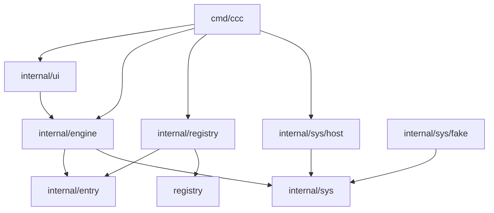

# ccc — subsystems

The parts `ccc` is made of, what each one owns, and which way the dependencies point. The
requirements they carry are in [00-requirements.md](00-requirements.md); how they work is in
[05-architecture.md](05-architecture.md).

An arrow means "imports". Nothing imports upwards, and `internal/entry` and `internal/sys`
import nothing of `ccc`.

| Part | Owns | Requirement it carries |
|---|---|---|
| `registry/` (repository root) | The shipped entries: one TOML file per tool, embedded into the program. No logic. | "What the shipped registry contains" |
| `internal/entry` | The data model of an entry and its validation: which fields exist, which combinations are legal. Knows nothing about files or the operating system. | "The contract of an entry" |
| `internal/registry` | Loading: reads the shipped entries and the user's registry directory, rejects unknown keys and invalid entries, lets a user file replace the shipped entry of the same name. | "The registry" |
| `internal/sys` | The contract with the outside world: running a command with a timeout, reading the environment, looking at the file system, measuring disk usage, removing a directory. Interfaces only. | — |
| `internal/sys/host` | The real implementation of that contract, including the guards on removal. | "Clean" |
| `internal/sys/fake` | An implementation for tests: scripted command results and an in-memory file system. | — |
| `internal/engine` | The three steps: detection, space check, clean. Turns entries into rows, runs the scan in parallel, cleans rows and reports what was freed. Uses the outside world only through `internal/sys`. | "Detection", "Space check", "Clean", the use cases |
| `internal/ui` | The interactive screen and the output of `ccc -c`. Shows what the engine reports; decides nothing about detection, sizes or cleaning. | "The terminal", the use cases |
| `cmd/ccc` | The entry point: reads the arguments, wires the parts together. | — |

The contract (`internal/sys`) and its implementations (`host`, `fake`) are separate packages,
so the engine can be tested in full without touching the machine it is built on.
