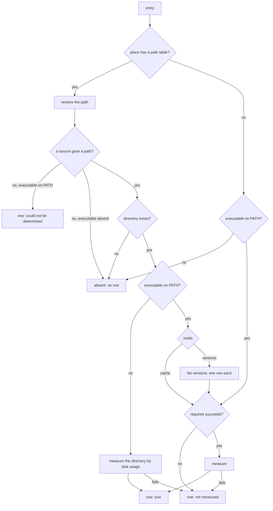
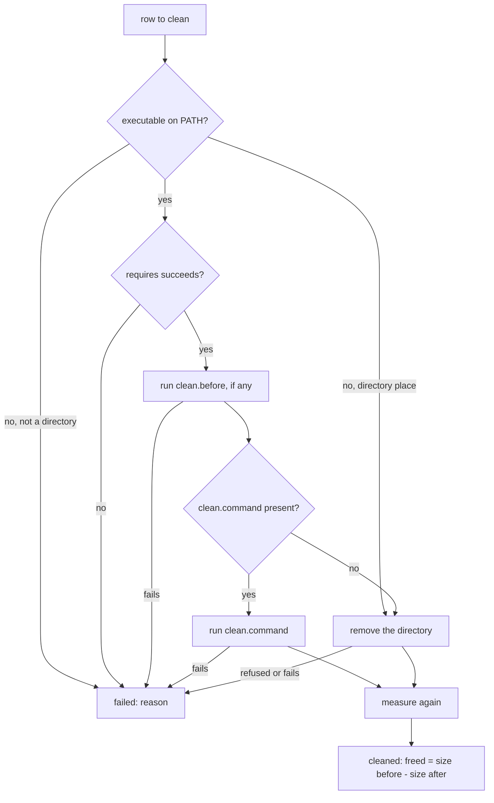

# ccc — architecture

How `ccc` works inside: the entry file, how an entry becomes rows, how a row is measured and
cleaned, and what happens when something fails. The parts named here are defined in
[03-subsystems.md](03-subsystems.md); the behaviour they implement is required by
[00-requirements.md](00-requirements.md).

Statements marked **Assumed** were decided here and not by the owner. Each one closes a point
the requirements leave open, and the owner can change it.

## The entry file

One TOML file describes one entry. The file name without `.toml` equals the entry's `name`. A
key that this section does not list makes the file invalid.

### Top level

| Key | Type | Required | Meaning |
|---|---|---|---|
| `kind` | `"tool"` or `"folder"` | yes | The kind of the entry |
| `name` | string | yes | Unique name of the entry; the row group is shown under it |
| `executable` | string | no, `tool` only | Name of the tool's executable looked up on `PATH` |
| `path` | string | yes, `folder` only | The directory of a folder entry |
| `places` | array of tables | at least one, `tool` only | The places of the tool |

A `folder` entry has no `places`: it is one directory place that holds a cache, measured by
disk usage and cleaned by removing the directory.

A `tool` entry without `executable` has no commands at all: its places are directories found
through `path.env` or a default, measured by disk usage and cleaned by removal.

### A place

| Key | Type | Meaning |
|---|---|---|
| `name` | string, required | Name of the place, unique inside the entry |
| `holds` | `"cache"` or `"versions"`, required | What the place holds |
| `requires.command` | string | A command that must succeed before the place is measured or cleaned |
| `path.command` | string | A command of the tool whose first output line is the path |
| `path.env` | string | Name of an environment variable holding the path |
| `path.subdir` | string | Appended to the path given by `path.command` or `path.env` |
| `path.default.macos`, `path.default.linux` | string | The full default path on that operating system |
| `list.command` | string | `versions` only: a command that prints the installed versions |
| `list.pattern` | string | `versions` only: a regular expression with one group, applied to each output line; the group is the version name |
| `measure.by` | `"disk-usage"` or `"command"`, required | How the size is obtained |
| `measure.path` | string | The directory to measure; `<path>` when absent |
| `measure.command` | string | `command` only: the command whose output holds the size |
| `measure.pattern` | string | `command` only: a regular expression with one group; the group is the size |
| `clean.before` | string | A command run before cleaning |
| `clean.command` | string | The tool's own clean command; when absent, the directory is removed |

A place without a `path` table is a place that is not a directory. It must have
`measure.by = "command"` and a `clean.command`, and it holds a cache: a `versions` place
always has a `path` table.

`measure.path` starts with `<path>` and stays inside it. In a `versions` place it contains
`<version>`, so that one row is never the directory of all versions.

**Assumed:** `path.subdir` — the requirements leave open how a path inside what the tool
prints is expressed.

**Assumed:** `requires.command` covers both measuring and cleaning — the requirements name a
precondition only for measuring.

### Strings

- A command is split into arguments by quoting rules — spaces separate, single and double
  quotes group — and run directly. There is no shell: no pipes, no redirection, no globbing,
  no variable expansion.
- A command gets no input. A command that would ask a question has to carry the tool's own
  flag that answers it (`docker image prune -a -f`).
- `<path>` and `<version>` are replaced in `measure.path`, `measure.command`, `clean.before`
  and `clean.command`. `<path>` is the resolved path of the place; `<version>` is one version
  name and is legal only in a `versions` place.
- In `path.default.*` and in the `path` of a folder, a leading `~` is the user's home
  directory and `$NAME` or `${NAME}` is an environment variable. A default that refers to a
  variable that is not set gives nothing.
- The size captured by `measure.pattern` is a whole number of bytes, or a number with a unit
  as tools print it (`4.2GB`, `350 kB`, `1.5GiB`).

### Where entries come from

- The shipped entries are the files in `registry/` at the repository root, embedded into the
  program at build time.
- The user's entries are the files in `$XDG_CONFIG_HOME/ccc/registry/`, or
  `~/.config/ccc/registry/` when the variable is not set, on both operating systems.
  **Assumed:** this location.
- A user file replaces the shipped entry of the same name as a whole. An invalid user file
  replaces nothing: the shipped entry of that name stays.
- An invalid user file does not stop `ccc`: the file is reported with the reason and the other
  entries load. An invalid shipped file fails the build's tests.

## From an entry to rows

- Path sources are tried in this order: `path.command`, then `path.env`, then the default for
  the current operating system. A source gives nothing when the executable is absent, the
  command fails or prints nothing, the variable is not set, or there is no default. The first
  source that gives a path wins and the others are not consulted.
- `path.subdir` is appended to what `path.command` or `path.env` gave, never to a default.
- A row is one of: a size in bytes; "not measured" with a reason; "could not be determined"
  with a reason. A place that is absent produces no row.
- When `list.command` fails, the place is one row "could not be determined". When it succeeds
  and lists nothing, the place produces no row.
- When the executable is not on `PATH` and the directory of a place exists, the tool counts as
  uninstalled. None of the entry's commands is run for that place — not `requires`, not
  `list`, not `measure.command`: the place is one row, measured by the disk usage of its
  directory.
- **Assumed:** a `versions` place of an uninstalled tool is one row for the whole directory.
  It stays a row of a `versions` place, so "clean everything" does not take it.
- **Assumed:** a place that is not a directory is absent when the executable is not on `PATH`,
  and otherwise goes straight to `requires` and measuring — the requirements leave its
  detection results open.

## Measuring

- `disk-usage` walks the directory and sums the allocated blocks of every file. A file with
  several hard links is counted once. Symbolic links are not followed. When any part of the
  directory cannot be read, the row is "not measured": a partial sum is not shown as a size.
- `command` runs `measure.command`, applies `measure.pattern` to the output and parses the
  group as a size. A failed command, a pattern that does not match and a size that does not
  parse each give "not measured" with that reason.
- Every command has a timeout, and a walk has its own longer one. A timeout gives
  "not measured", or "could not be determined" when it happened while resolving the path.
- All places are detected and measured in parallel, with a limit on how many run at once.
- Before the scan starts, the engine gives the list of the places it is going to look at:
  for each, the entry, the name of the place — for a folder, its path as the entry gives
  it — and its position. During the scan it delivers
  one result per place as each finishes: the rows of that place, which may be none. A screen
  can therefore show every place as being measured and replace it with its rows, or drop it,
  when its result arrives.
- A row carries the path it stands for — the folder's path, or the resolved directory —
  whenever that path is known, also when the row could not be measured.

The timeouts and the parallel limit are settings with defaults, not constants inside the
engine.

## Cleaning

- Rows are cleaned one after another, never in parallel. A failed row does not stop the next.
- The result of a row is "cleaned" with the bytes freed, or "failed" with the tool's message.
  When the place no longer exists after cleaning, the freed size is the size before.
- "Clean everything" takes every row of a `cache` place and every folder row. A row of a
  `versions` place is cleaned only when it was selected explicitly.
- When the executable is gone and the directory is still there, the directory is removed and
  none of the entry's commands is run: not `requires`, not `clean.before`, not `clean.command`.
- A row is cleaned as the scan saw it. When the executable was on `PATH` at the scan and is
  gone at cleaning, or the other way round, the row fails with the request to scan again and
  nothing is removed.
- Right before a directory is removed, the place is resolved again. When it no longer resolves
  to the directory the row was scanned at, the row fails and nothing is removed.

### Guards on removing a directory

Removal is the one operation that cannot be undone, so the real implementation refuses it
unless every one of these holds, and a refusal is a failed row with the reason:

- the path is absolute, contains no `..` and is already in its normal form;
- the path is not the root, not the user's home directory, and not a directory that contains
  the home directory;
- the path lies at least two levels below the root;
- the path itself is a directory and not a symbolic link;
- the path is exactly what detection resolved for that row.

When removal fails because files are read-only, write permission is added to the directory's
own content and removal is tried once more.

`ccc` never raises its privileges. A place that needs administrator rights ends as
"not measured" or as a failed row.

## Extension points

- A new tool is a new TOML file. Nothing in the program names a tool.
- A new way to measure or to clean is a new value of `measure.by`, or a new key of `clean`,
  handled in the engine in one place.
- A new operating system is a new key under `path.default`.
- The screen and `ccc -c` consume the same stream of rows and results from the engine, so
  another way to show them needs no change in the engine.
